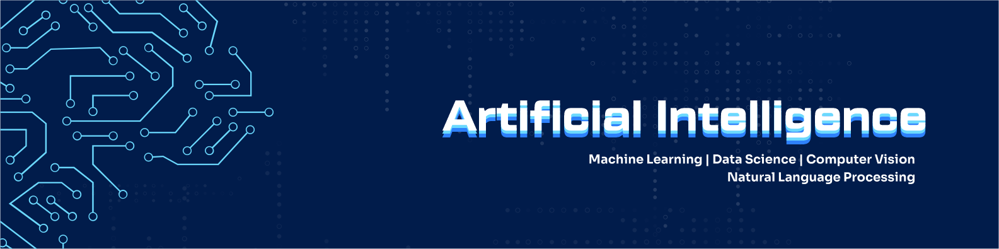

<div align="center">



# Daniel Akhabue
### Senior AI Engineer · Senior Data Scientist · Robotics Researcher · Kaggle Expert (#416 Global Rank)

*I build intelligent systems that work in production: not just in notebooks.*
*From multi-agent banking AI to computer vision security systems, I bridge cutting-edge AI with real enterprise impact.*


[](https://bit.ly/dan-akhabue)
[](https://www.linkedin.com/in/daniel-akhabue/)
[](https://www.kaggle.com/danielakhabue)
[](https://quantumreports.medium.com/)
[](https://twitter.com/_danielakhabue)
[](https://zindi.africa/users/Oracle_)


</div>

---

## 👤 About Me

I'm a **Senior AI Engineer and Data Scientist** based in Lagos, Nigeria, with **5+ years** of experience building and deploying production-grade AI systems across banking, healthcare, government, EdTech, and Enterprise Systems.

I specialize in the full AI lifecycle: from data engineering and model training to LLM orchestration, multi-agent systems, and cloud-native MLOps on AWS, GCP, and Azure. I don't just build models; I build systems that enterprises trust.

- 🏆 **Kaggle Expert**: Global Rank **#416**
- 🥇 **4x Hackathon Winner**: including 1st Place at Zaka 2023 AI Challenge & Deep Learning IndabaX Nigeria
- 🎙️ **International Speaker**: PyCon Kenya 2025 · Datafest Africa 2024 · Black in Robotics 2025 (USA)
- 🏫 **AI Faculty**, Univaciti TeSA Program: training the next generation of production-ready AI engineers
- ☁️ Contributed to Qucoon's **AWS AI Competency** in Generative AI & Machine Learning Services
- 🌍 **Organising Team Member & Faculty**, [AISOC (AI Summer of Code)](https://aisummerofcode.org/): the world's largest community for incubating AI talents
- ✍️ I write about AI strategy and engineering at [Quantum Reports on Medium](https://quantumreports.medium.com/)
- 🤖 **Robotics Researcher**: exploring the intersection of AI, perception, and autonomous systems
- ⚡ Fun fact: I'm a certified **Data Bender**: I make data do things it didn't know it could

### 🔬 Research Interests

My research lies at the intersection of autonomous systems, multi-agent orchestration, and edge intelligence. I focus on the architectural design of communication mesh networks and decentralized coordination protocols for multi-robot swarm systems spanning aerial, terrestrial, and aquatic platforms. A core emphasis is cost-efficiency and fault tolerance through localized machine learning deployed directly on resource-constrained embedded hardware.

I am further interested in federated learning frameworks for collaborative model training across distributed robot nodes, and reinforcement learning approaches for adaptive control and emergent coordination in multi-agent settings. Beyond low-level control and multi-robot path planning, I am interested in distributed Vision-Language Model (VLM) reasoning across robot networks to enable collaborative, real-time spatial awareness and autonomous decision-making in complex, dynamic environments.

---

## 🚀 Featured Projects

### 🤖 Federated Anomaly Detection on Edge Devices *(Best Poster — Deep Learning Indaba 2026)*
**Problem:** FedAvg is assumed to outperform local training on edge devices, but this assumption is untested in the minimal-client regime (2–3 physical devices) that most real deployments start with  
**Solution:** Ran controlled experiments on real heterogeneous hardware (Raspberry Pi 4 ARM64 + x86_64 gateway) comparing local-only, centralized, and FedAvg on system telemetry anomaly detection — then isolated client count from heterogeneity via a sub-client sweep  
**Finding:** FedAvg *fails* at 2 clients (0.789 F1 vs. 0.895 centralized), peaks at round 5 then degrades — client count, not data heterogeneity, is the causal variable. Above ~6 clients, FedAvg recovers and wins  
**Stack:** `Federated Learning` `FedAvg` `Raspberry Pi` `Edge AI` `PyTorch` `Anomaly Detection` `Python`

---

### 🏦 Nigeria's First Cloud-Native Agentic Banking AI
**Problem:** Enterprise digital banking overwhelmed by customer enquiries, manual transactions, and fragmented multilingual support  
**Solution:** Pioneered a serverless, multi-agent conversational AI system on **AWS Bedrock + Lambda** with intelligent routing, stateful context management, and PCI-DSS compliant core banking integration  
**Impact:** Scaled transactional banking by **70%** · Cut customer enquiry workloads by **66%** · Achieved **>99% accuracy** with sub-second latency  
**Stack:** `AWS Bedrock` `Lambda` `RAG` `Multi-Agent Systems` `Python`

---

### 🛡️ AI-Guided Multi-Source Security System
**Problem:** Traditional surveillance unable to process multi-modal, real-time inputs for comprehensive threat detection  
**Solution:** Architected a CV pipeline fusing **drone imagery, satellite feeds, thermal cameras, and ground sensors** for 24/7 anomaly and intrusion detection with geospatial analysis  
**Impact:** Enabled border security, infrastructure protection, and remote area surveillance at scale  
**Stack:** `PyTorch` `OpenCV` `Geospatial AI` `AWS` `Deep Learning`

---

### 🎓 AI Course Generation Engine: Varsityscape
**Problem:** Manual EdTech content development was slow, expensive, and inconsistent across global cohorts  
**Solution:** Built a proprietary AI model for automated course generation using **Azure AI**, integrated with Agentic student assistants for real-time learning support  
**Impact:** Reduced content development cycles by **95%** · Improved query resolution by **60%** across **10K+ student interactions**  
**Stack:** `Azure AI` `LangChain` `Agentic AI` `Python` `FastAPI`

---

### 🛒 Agentic AI Customer Support: Vendease
**Problem:** E-procurement customers faced slow, fragmented data access and poor support experience  
**Solution:** Led design of an Agentic AI support system backed by a **500+ test case evaluation framework** covering hallucination detection and tool-use accuracy  
**Impact:** Accelerated data access and purchase information retrieval by **90%**  
**Stack:** `Python` `LangChain` `SQL` `MLOps` `Drift Detection`

> 🗂️ See all projects → [bit.ly/dan-akhabue](https://bit.ly/dan-akhabue)

---

## 🛠️ Tech Stack

### Languages


### AI / ML / Deep Learning


### Cloud & MLOps


### Data & Visualization


---

## 🏆 Awards & Recognition

| | Achievement |
|---|---|
| 🏆 | Deep Learning Indaba 2026: **Best Poster Award** — *Does Federated Learning Need a Crowd?* (Poster GP-80) |
| 🥇 | Zaka 2023 AI Challenge: **1st Place** (Team Synergy) |
| 🥉 | Deep Learning IndabaX Nigeria Hackathon: **3rd Place** |
| 🏅 | **4x Hackathon Winner** overall |
| 🎖️ | Kaggle Expert: Global Rank **#416** |
| 🎙️ | Speaker: PyCon Kenya 2025 · Datafest Africa 2024 · Black in Robotics 2025 (USA) |
| ☁️ | Contributed to Qucoon's **AWS AI Competency**: Generative AI & ML Services |
| 🌍 | Organising Team Member & Faculty: **AISOC (AI Summer of Code)** |

---

## 📈 GitHub Stats

<div align="center">


</div>

---

## 🌱 Currently Exploring

```python
current_focus = {
    "at_work":     ["Multi-Agent AI Systems", "IoT + Computer Vision Fusion", "AWS Bedrock"],
    "research":    [
        "Swarm & Chain Drone Systems: architecture, mesh comms, decentralized coordination",
        "Edge ML on resource-constrained embedded hardware with fault tolerance",
        "Distributed VLM reasoning across swarm networks for real-time spatial awareness",
        "Multi-robot path planning & autonomous decision-making for aerial missions",
        "Deploying intelligent autonomous systems in infrastructure-constrained environments"
    ],
    "teaching":    ["Production AI Engineering", "Cloud-Native MLOps", "Generative AI Systems"],
    "competing":   ["Kaggle", "Zindi Africa"],
    "north_star":  "Is the AI solving the problem it's expected to solve, under acceptable conditions?"
}
```

---

## ✍️ Articles & Publications

- 📄 [**Does Federated Learning Need a Crowd? Client Count, Not Heterogeneity, Explains FedAvg's Failure on Real Edge Hardware**](https://github.com/Apprentice-doa/Federated-Anomaly-Detection-on-Edge-Devices) *(Best Poster — Deep Learning Indaba 2026, Poster GP-80)*
- 📄 [**My Last Umoja Hack Africa Experience as an Undergrad**: The Good, the Bad, and the Ugly](https://quantumreports.medium.com/my-last-umoja-hack-africa-experience-as-an-undergrad-the-good-the-bad-and-the-ugly-dbfbaabfb6a4)
- 📄 [**Driving Electoral Integrity with Data Visualization**: How a Power BI Dashboard Can Revolutionize Your Election Process](https://quantumreports.medium.com/driving-electoral-integrity-with-data-visualization-how-a-power-bi-dashboard-can-revolutionize-d76aa8f66239)
- 📄 [**Is Hacking Together Your First Python Package Difficult?**: A guide for data students](https://medium.com/@quantumreports/is-writing-your-first-python-package-difficult-2577a61f97ee)
- 📄 [**Becoming a Contributor to the Open-Source Data Community**](https://medium.com/@quantumreports/becoming-a-contributor-to-the-open-source-data-community-aaf7257adda7)
- 📄 [**Exploratory Data Analyses: NPFL's Teams and Standings**: A novel data mining & EDA project](https://medium.com/@quantumreports/exploratory-data-analyses-npfls-teams-and-standings-fa0a513f02dd)

> 📚 Read more → [Quantum Reports on Medium](https://quantumreports.medium.com/)

---

## 📬 Let's Connect

Open to **consulting engagements, speaking invitations, research collaborations**, and conversations about hard AI problems.

📧 **akdaniel0009@gmail.com**

<div align="center">

*"Before you optimise your AI: or swap that Sonnet for an Opus: make sure you've answered the North Star Question."*

</div>

---

<div align="center">
<sub>⭐ If my work is useful to you, consider starring a repo! | Last updated: May 2026</sub>
</div>
